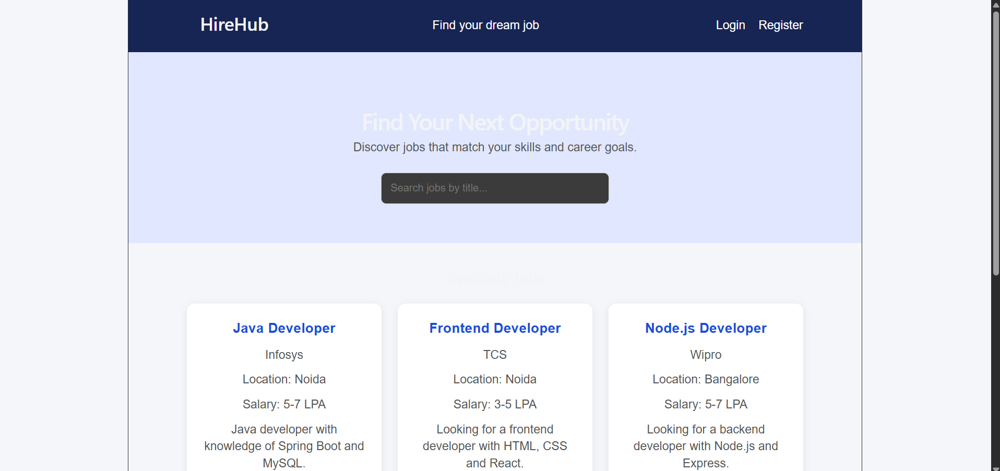
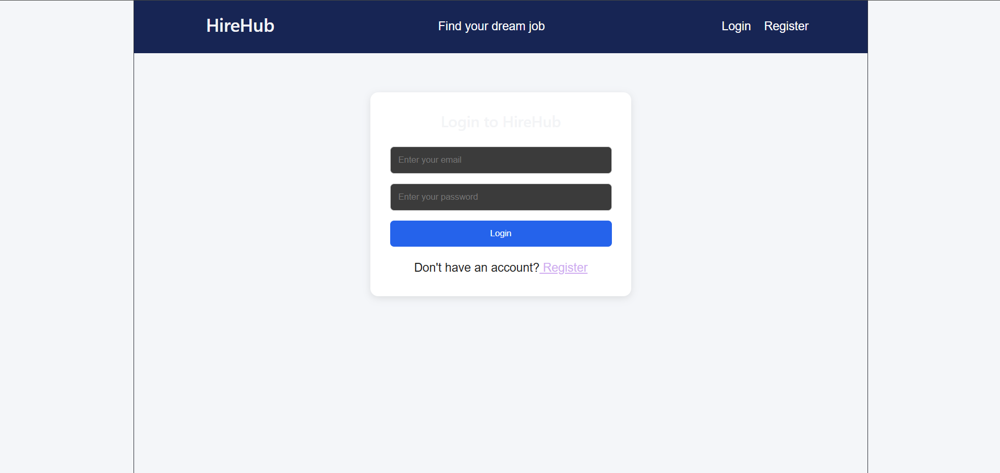
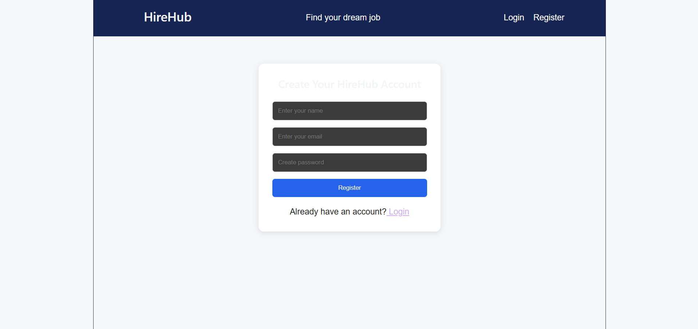
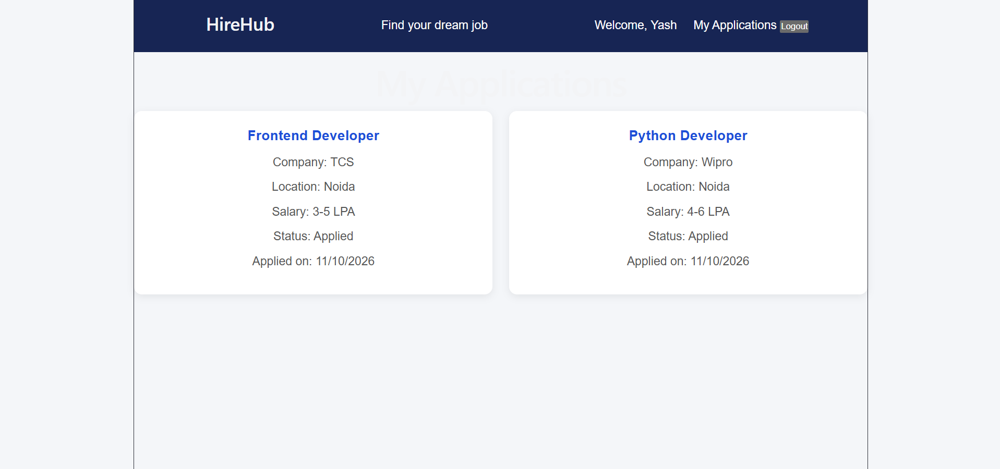
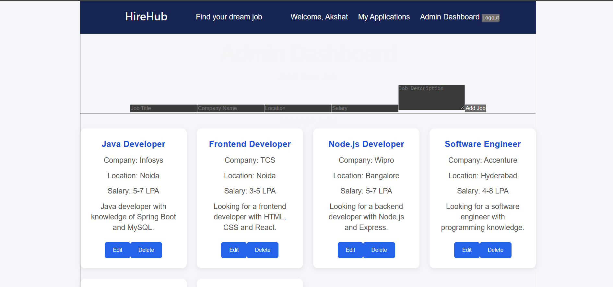
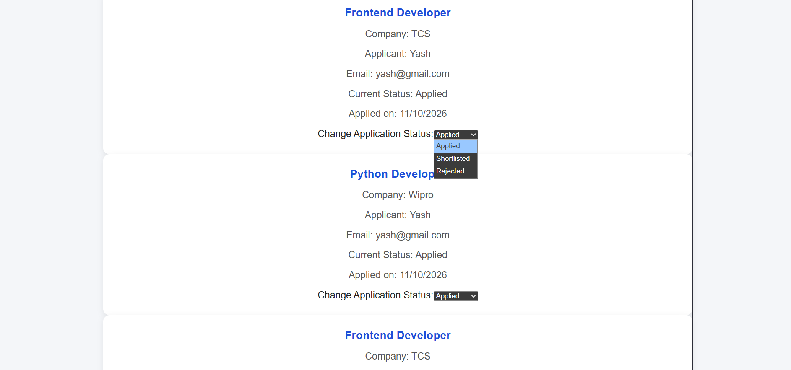
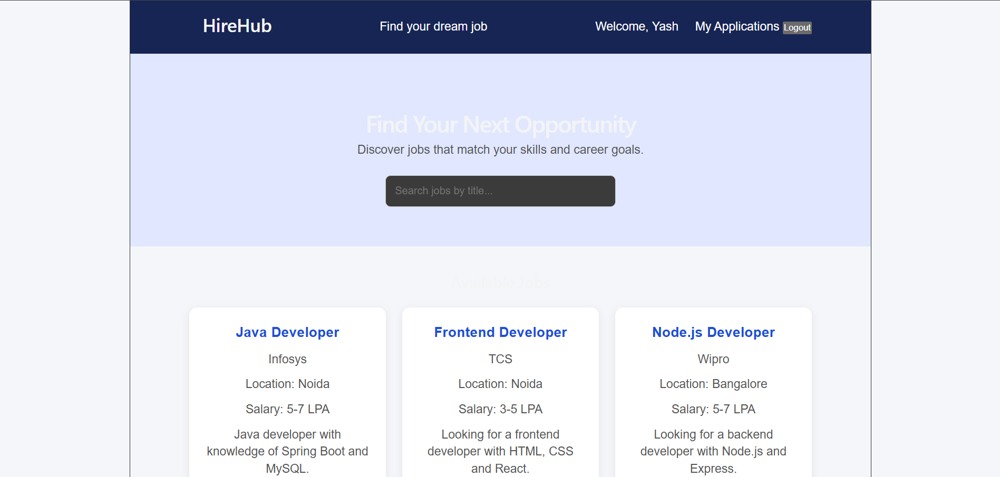

# HireHub – Job Portal Management System

## Project Overview

HireHub is a full-stack Job Portal Management System that connects job seekers with job opportunities. Users can register, log in, browse available jobs, apply for jobs, and track their application status. Administrators can manage job listings and monitor applications submitted by users.

## Technologies Used

**Frontend**
- React.js
- HTML, CSS, JavaScript
- Axios
- React Router

**Backend**
- Node.js
- Express.js
- REST APIs
- JWT Authentication
- bcryptjs for password hashing

**Database**
- MySQL
- mysql2

**Development Tools**
- Visual Studio Code
- MySQL Workbench
- Postman
- Git and GitHub

## Main Features

### User Features
- User registration and login
- Secure password hashing
- Browse and search job listings
- Apply for available jobs
- View personal job applications
- Track application status
- Logout functionality

### Admin Features
- Admin authentication and role-based access
- Add new job listings
- Edit existing job listings
- Delete job listings
- View applications submitted by users
- Update application status to Applied, Shortlisted, or Rejected

## Project Structure

```text
HireHub/
├── backend/
│   ├── config/
│   │   └── db.js
│   ├── middleware/
│   │   └── auth.js
│   ├── server.js
│   └── .env
│
├── frontend/
│   ├── src/
│   │   ├── pages/
│   │   ├── App.jsx
│   │   └── App.css
│   └── package.json
│
├── .gitignore
└── README.md
```

## Database Design

The application uses three main tables:

1. **users** – Stores user details, hashed passwords, and roles.
2. **jobs** – Stores job title, company, location, salary, and description.
3. **applications** – Stores job applications, user references, job references, and application status.

The applications table uses foreign keys to connect users and jobs. A unique constraint prevents the same user from applying to the same job more than once.

## Installation and Setup

### 1. Clone the repository

```bash
git clone https://github.com/Aksh49/HireHub-Job-Portal.git
cd HireHub-Job-Portal
```

### 2. Backend setup

```bash
cd backend
npm install
```

Create a `.env` file inside the backend folder:

```env
DB_HOST=localhost
DB_USER=root
DB_PASSWORD=your_mysql_password
DB_NAME=hirehub
PORT=5000
JWT_SECRET=your_secret_key
```

### 3. Database setup

Create the `hirehub` database in MySQL Workbench and execute the SQL table creation scripts.

### 4. Start the backend

```bash
npm run dev
```

### 5. Frontend setup

Open another terminal:

```bash
cd frontend
npm install
npm run dev
```

Open the local frontend URL shown in the terminal.

## Authentication and Authorization

- Passwords are hashed using bcryptjs before storage.
- JWT is used to authenticate users.
- Protected routes verify the JWT token.
- Role-based middleware restricts admin operations to admin accounts.
- Normal users cannot access admin-only APIs.

## Screenshots

### Homepage


### Login Page


### Register Page


### My Applications


### Admin Dashboard


### Application Status


### User Dashboard


## Future Enhancements

- Resume upload
- Job application email notifications
- Advanced job filters
- Pagination
- Deployment to a cloud platform

## Author

Akshat Pal

GitHub: https://github.com/Aksh49